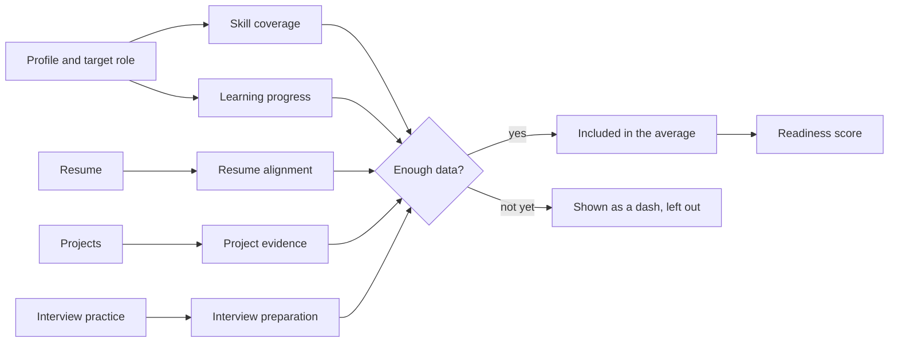

<div align="center">

<!-- Replace with a screenshot or short GIF of the dashboard: docs/hero.png -->


# CareerTwin

**Know where you stand before you apply.**

CareerTwin compares your skills with a target role and shows exactly how every score is calculated, so you can see what to fix next instead of guessing.


</div>

---

## Why this exists

Most students apply to roles without knowing how close they are. Resume checkers give a single mystery number. CareerTwin does the opposite: every score comes with the reasoning behind it, and a score only counts once there is enough data to back it up.

Open the demo profile (a fictional student, *Aarav Rao*, aiming for an ML Engineer Intern role) and you can see the whole product in under a minute.

## Features

| | |
|---|---|
| **Readiness score** | One headline number, built as the average of only those scores that have enough data. Nothing is guessed. |
| **Five transparent scores** | Skill coverage, learning progress, resume alignment, project evidence and interview preparation. Each card expands to show how it was worked out. |
| **3D skill towers** | Every skill area is a tower. A glass tower shows the skills you list, and a solid tower shows the ones you have proven in a real project. Drag to rotate, hover for detail. |
| **Resume match** | Compare your resume with a target role and see the gaps. |
| **Projects and interview practice** | Attach projects to skills as proof, and rehearse interview questions. |
| **Skill roadmap** | Milestones you can tick off, which feed your learning progress. |
| **Showcase** | A clean summary you can copy, or print and save as a PDF to share. |
| **Sign in and sign up** | Create an account, or explore with the demo profile. |
| **Settings and privacy** | You control your data. |

## The skill towers

The signature view. Each tower is one skill area, and four or more skills fill it.

- **Glass tower (blue):** skills you list.
- **Solid tower (mint):** skills backed by a project.
- A radar sweep passes over the floor and lights each tower as it goes by.
- Drag to spin with inertia. Hover or tap a tower to see how many of its listed skills are proven.
- Respects `prefers-reduced-motion`.

It is plain SVG with a hand-written 3D projection (no WebGL, no 3D library), so it stays light and prints cleanly.

## How the score works



A score with no data shows a dash instead of a made-up number, and it is left out of the readiness average.

## Tech stack

- **React** and **TypeScript** for the app
- **Vite** for development and builds
- **Tailwind CSS v4** with a custom theme (design tokens live in `src/index.css`)
- **lucide-react** for icons
- **Bricolage Grotesque** and **DM Sans** for type

## Getting started

You need [Node.js](https://nodejs.org) 18 or newer.

```bash
git clone https://github.com/ayeshaiee11/CareerTwin.git
cd CareerTwin
npm install
npm run dev
```

Open <http://localhost:5173>. Click **Explore with demo data** to look around without making an account.

To make a production build:

```bash
npm run build
npm run preview
```

> If the project has a separate `server` folder, install and start it in its own terminal the same way (`cd server`, `npm install`, `npm run dev`). <!-- Edit or delete this note to match your setup. -->

## Project structure

```
src/
  main.tsx        App entry, wrapped in the sign in gate
  App.tsx         Pages and navigation
  AuthGate.tsx    Shows sign in or sign up until someone is in
  AuthPage.tsx    The sign in / create account screen
  Radar3d.tsx     The 3D skill towers
  ui.tsx          Shared buttons, fields, alerts, CountUp
  index.css       Theme tokens, background, buttons, motion
```

## Design

A blue-black slate ground, blue for *you*, and mint for what you have *proven*.

| Role | Colour |
|---|---|
| Background | `#0a0f16` |
| Panel | `#111923` |
| You (accent) | `#4f8cff` |
| Proven | `#34d399` |
| Secondary | `#22d3ee` |

Motion is used sparingly: the towers growing in, the radar sweep, and buttons that respond to a press. Everything animated switches off for people who prefer reduced motion.

## Accounts and privacy

Right now, accounts are stored in your browser's `localStorage` so the project runs with no backend. That is fine for a demo, but it is not real security and accounts do not follow you between devices. To use real accounts, replace `login()` and `signup()` in `src/AuthGate.tsx` with calls to your own server.

## Roadmap

- [ ] Real backend accounts and saved profiles
- [ ] Import a resume from PDF
- [ ] Compare against several target roles at once
- [ ] Share a read-only public Showcase link
- [ ] Light theme

## Contributing

Ideas and fixes are welcome. Open an issue first to talk about what you would like to change, then send a pull request.

## Author

Made by [@ayeshaiee11](https://github.com/ayeshaiee11).

## License

MIT. See `LICENSE`.
